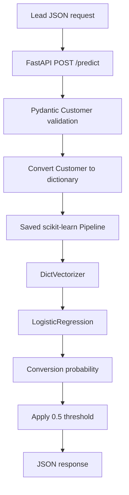

# Lead Scoring Prediction API

A machine-learning API that estimates the probability that a prospective customer will convert. The project uses a scikit-learn `Pipeline` with `DictVectorizer` and `LogisticRegression`, exposes predictions through FastAPI, validates requests with Pydantic, and packages the service with Docker.

<p align="center">
  <a href="https://github.com/mohammed-gh99/Lead_Scoring_prediction_API">
    
  </a>
  <a href="https://www.python.org/">
    
  </a>
  <a href="https://scikit-learn.org/">
    
  </a>
  <a href="https://fastapi.tiangolo.com/">
    
  </a>
  <a href="https://docs.pydantic.dev/">
    
  </a>
  <a href="https://docs.astral.sh/uv/">
    
  </a>
  <a href="https://www.docker.com/">
    
  </a>
  <a href="https://aws.amazon.com/elasticbeanstalk/">
    
  </a>
</p>

<p align="center">
  <a href="#quick-start">Quick start</a> ·
  <a href="#api-reference">API reference</a> ·
  <a href="#docker">Docker</a> ·
  <a href="#aws-deployment-record">AWS deployment</a>
</p>

> [!NOTE]
> The AWS deployment was completed and tested successfully, then terminated to avoid ongoing hosting costs. **There is no active public demo.** You can run the API locally or with Docker using the instructions below.

---

## Contents

<details open>
<summary><strong>Show / hide project navigation</strong></summary>

- [Project overview](#project-overview)
- [Quick start](#quick-start)
- [How it works](#how-it-works)
- [Model and evaluation](#model-and-evaluation)
- [Tech stack](#tech-stack)
- [Project structure](#project-structure)
- [API reference](#api-reference)
  - [Request example](#request-example)
  - [Response example](#response-example)
  - [Input validation](#input-validation)
- [Run locally](#run-locally)
- [Docker](#docker)
- [Retrain the model](#retrain-the-model)
- [AWS deployment record](#aws-deployment-record)
- [Limitations and security](#limitations-and-security)
</details>

## Project overview

The API accepts a lead/customer record as JSON and returns:

| Response field | Type | Description |
|---|---|---|
| `converted_probability` | `float` | Estimated probability that the lead will convert, from `0` to `1`. |
| `converted` | `boolean` | Predicted class using a decision threshold of `0.5`. |

The trained pipeline is serialized to `model.bin`. When the API starts, it loads this artifact and uses the same fitted preprocessing and classification steps for inference.

## Quick start

Get the service running locally with these commands:

```bash
git clone https://github.com/mohammed-gh99/Lead_Scoring_prediction_API.git
cd Lead_Scoring_prediction_API
uv sync --locked
uv run uvicorn predict:app --host 0.0.0.0 --port 9696
```

Then open the interactive API documentation at **[http://localhost:9696/docs](http://localhost:9696/docs)**.

## How it works



1. A client sends a lead record to `POST /predict`.
2. FastAPI validates the request with the Pydantic `Customer` model.
3. The validated model is converted to a Python dictionary.
4. The dictionary is wrapped in a one-record list and passed to the saved pipeline.
5. The API returns the conversion probability and the threshold-based class.

## Model and evaluation

| Item | Configuration |
|---|---|
| Algorithm | Logistic Regression |
| Preprocessing | `DictVectorizer` inside a scikit-learn `Pipeline` |
| Solver | `liblinear` |
| Regularization parameter | `C=5` |
| Classification threshold | `0.5` |
| Evaluation metric | ROC AUC |
| Recorded test AUC | Approximately **0.7944** |
| Model artifact | `model.bin` |

The fitted pipeline keeps feature vectorization and prediction together, so inference uses the preprocessing learned during training.

<details>
<summary><strong>What does the probability mean?</strong></summary>

`converted_probability` is the model's estimated probability for class `1` (`converted`). The API converts that probability into a boolean using the fixed threshold `0.5`:

- `true` when the probability is greater than or equal to `0.5`.
- `false` when the probability is below `0.5`.

A probability is a model estimate, not a guarantee that a lead will convert.
</details>

## Tech stack

| Technology | Purpose |
|---|---|
| Python | Application and model code |
| pandas / NumPy | Data loading and numerical operations |
| scikit-learn | Feature vectorization, pipeline, and classification |
| FastAPI | REST API framework |
| Pydantic | Request and response validation |
| Uvicorn | ASGI server |
| uv | Python dependency and environment management |
| Docker | Containerization |
| AWS Elastic Beanstalk | Cloud deployment exercise |

## Project structure

```text
.
├── .elasticbeanstalk/
│   └── config.yml          # Elastic Beanstalk application and region settings
├── .dockerignore           # Files excluded from the Docker build context
├── .gitignore
├── Dockerfile
├── Lead_Scoring_1.ipynb    # Exploration, model development, and evaluation
├── data-week-3-lead.csv    # Training dataset
├── model.bin               # Trained scikit-learn pipeline (C=5)
├── predict.py              # FastAPI application and prediction endpoint
├── pyproject.toml           # Project metadata and dependencies
├── train.py                 # Data preparation, training, and serialization
└── uv.lock                  # Locked dependency versions
```

## API reference

### Endpoint

```http
POST /predict
Content-Type: application/json
```

### Request example

<details>
<summary><strong>Expand example customer request</strong></summary>

```json
{
  "lead_source": "organic_search",
  "industry": "technology",
  "employment_status": "employed",
  "location": "africa",
  "annual_income": 50000,
  "number_of_courses_viewed": 5,
  "interaction_count": 10,
  "lead_score": 80
}
```

</details>

### Response example

<details open>
<summary><strong>Show example prediction response</strong></summary>

```json
{
  "converted_probability": 0.9843794991646138,
  "converted": true
}
```

This is an observed result for the example request above during the deployment test. Other input records can produce different predictions.
</details>

### Input validation

The `Customer` schema restricts categorical fields to the values represented in the training data:

| Field | Accepted values |
|---|---|
| `lead_source` | `events`, `organic_search`, `paid_ads`, `referral`, `social_media` |
| `industry` | `education`, `finance`, `healthcare`, `manufacturing`, `retail`, `technology` |
| `employment_status` | `employed`, `self_employed`, `student`, `unemployed` |
| `location` | `africa`, `asia`, `europe`, `north_america`, `south_america` |

Numeric inputs must be non-negative. Non-finite values are rejected for `annual_income` and `lead_score`. Invalid request data is rejected with HTTP `422` before reaching the model.

<details>
<summary><strong>Example validation error</strong></summary>

Submitting an unsupported category such as `"lead_source": "website"` returns HTTP `422 Unprocessable Entity` because `website` is not an allowed `Literal` value.
</details>

## Run locally

### Requirements

- Python 3.14 or newer, as specified in `pyproject.toml`.
- [uv](https://docs.astral.sh/uv/).

### Install dependencies

```bash
uv sync --locked
```

### Start the API

```bash
uv run uvicorn predict:app --host 0.0.0.0 --port 9696 --reload
```

| Resource | Local address |
|---|---|
| API | `http://localhost:9696` |
| Swagger UI | [http://localhost:9696/docs](http://localhost:9696/docs) |
| ReDoc | [http://localhost:9696/redoc](http://localhost:9696/redoc) |

Stop the server with `Ctrl+C`.

## Docker

The Docker image contains the Python runtime, production dependencies, FastAPI application, and trained model. Development-only packages such as Jupyter are excluded from the image.

<details open>
<summary><strong>Build and run with Docker</strong></summary>

**1. Build the image**

```bash
docker build -t lead-scoring-api .
```

**2. Start the container**

```bash
docker run --rm -p 9696:9696 lead-scoring-api
```

**3. Open the API documentation**

Visit [http://localhost:9696/docs](http://localhost:9696/docs).

**If port 9696 is already in use on the host**, map another host port to the container's port:

```bash
docker run --rm -p 9697:9696 lead-scoring-api
```

Then open [http://localhost:9697/docs](http://localhost:9697/docs).

Stop the container with `Ctrl+C`. The `--rm` option removes the stopped container while keeping the Docker image.
</details>

## Retrain the model

The training workflow is in `train.py`. To regenerate `model.bin`, run:

```bash
uv run python train.py
```

The training script loads the dataset from the raw GitHub URL configured in the script, prepares the features, fits the pipeline with `C=5`, and saves the trained pipeline to `model.bin`.

The API does not retrain the model at startup; it loads the existing `model.bin` artifact.

## AWS deployment record

The Dockerized API was successfully deployed to **AWS Elastic Beanstalk** as a cloud deployment exercise.

| Setting | Verified value |
|---|---|
| AWS service | Elastic Beanstalk |
| Application | `lead-scoring-prediction-api` |
| Environment | `lead-scoring-prediction-env` |
| Region | `eu-north-1` (Stockholm) |
| Platform | Docker on 64-bit Amazon Linux 2023 |
| Environment type | Single instance (no load balancer) |
| EC2 instance type | `t3.micro` |
| Container port | `9696` |
| Environment status during verification | `Ready` |
| Environment health during verification | `Green` |
| API verification | `POST /predict` returned HTTP `200` |

<details>
<summary><strong>Expand deployment verification and cleanup details</strong></summary>

- The environment reached `Ready` status with `Green` health.
- The public `POST /predict` endpoint returned HTTP `200` and the expected prediction for the example request.
- The deployment result matched the local FastAPI and Docker result: `0.9843794991646138` probability and `true` class for the example request.
- The Elastic Beanstalk environment was terminated after testing to avoid ongoing hosting costs.
- The application version and its S3 source ZIP were deleted after testing.
- The EC2 instance was confirmed as `terminated`.
- The deployment's public IP was no longer allocated.
- No available EBS volumes or deployment-specific security group were found in the cleanup checks.

</details>

> [!WARNING]
> **The AWS demo is no longer active.** The deployment details document a completed deployment exercise; they do not represent a currently available public API. Run the service locally or with Docker using the instructions above.

## Limitations and security

- This is an educational machine-learning deployment project, not a production-ready lead-management system.
- The API does not currently implement authentication, authorization, rate limiting, or production monitoring.
- The classification threshold is fixed at `0.5`; a probability is a model estimate, not a guarantee of conversion.
- The model artifact is loaded with Pickle. Only load `model.bin` from a trusted source because loading an untrusted Pickle file can execute arbitrary code.
- Do not send real customer personal information to a publicly exposed instance without appropriate privacy and security controls.

---

<p align="center">
  Built as a hands-on machine-learning deployment project with Python, scikit-learn, FastAPI, Docker, and AWS.
  <br />
  <a href="#lead-scoring-prediction-api">Back to top ↑</a>
</p>
